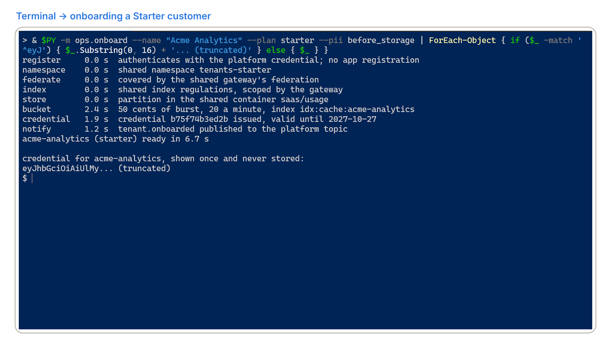
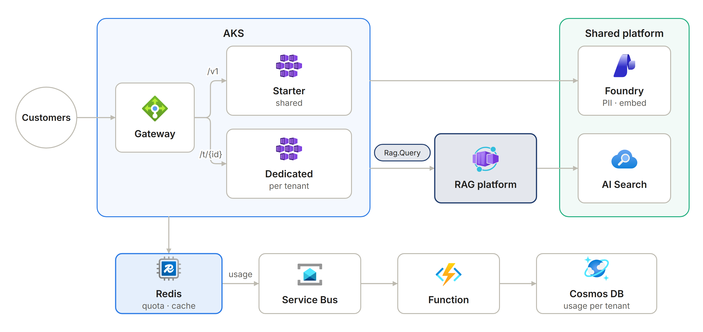
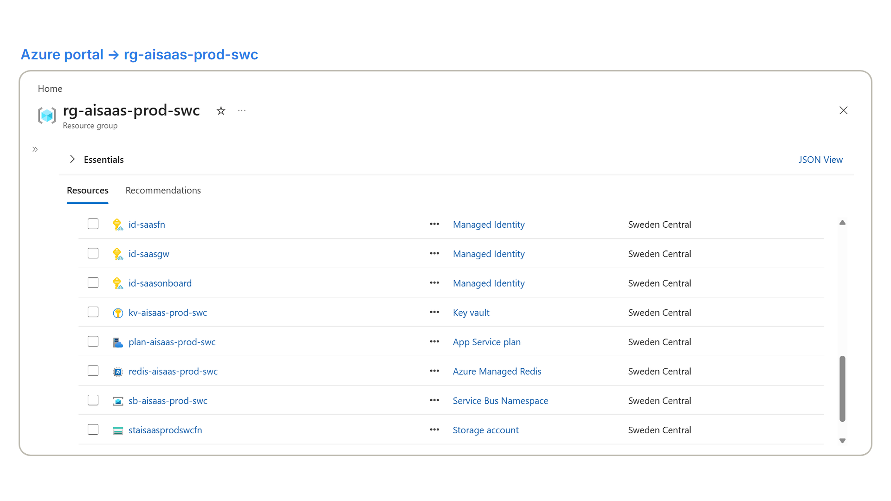
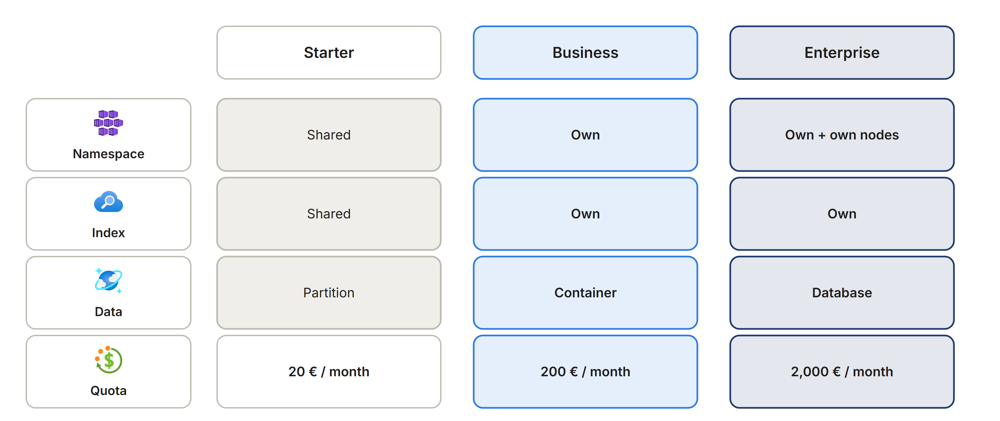
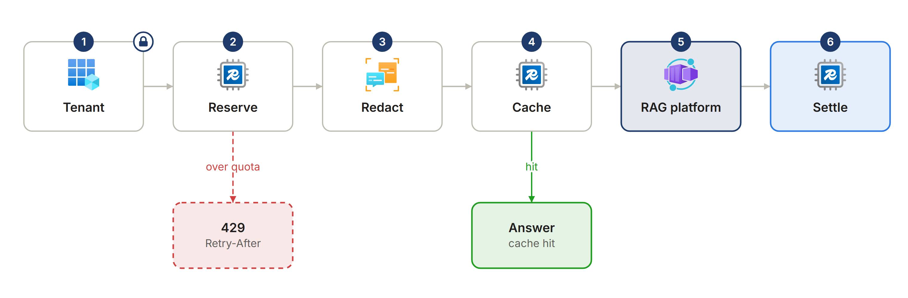
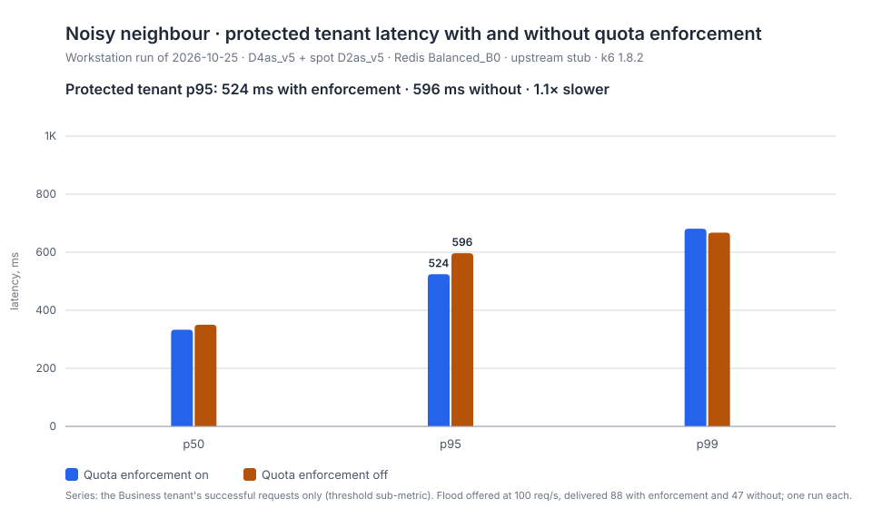
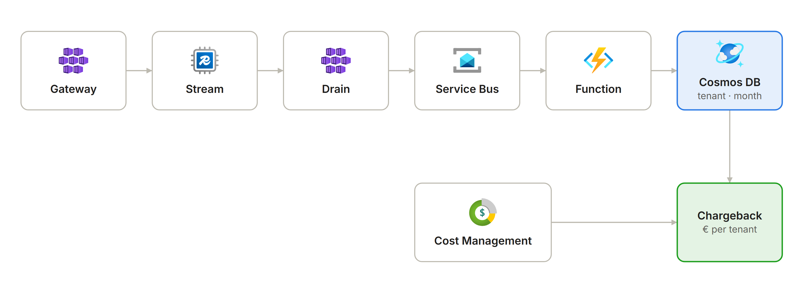

# Regulatory Intelligence as a Service

Built by **Rodrigo Martín Gómez del Moral Herranz**

[](https://github.com/Rodrigo-GomezdelMoral)&nbsp;&nbsp;[](https://www.linkedin.com/in/rodrigo-mart%C3%ADn-g%C3%B3mez-del-moral-herranz)&nbsp;&nbsp;[](https://rodrigogomezdelmoralherranz.es)

The regulatory-intelligence platform in `azure-rag-platform` works. This repository is what turns it
into a business: the same capability sold to a hundred companies, each onboarded in under two minutes,
isolated from the others in compute, data and quota, metered as an event stream, and costed from two
independent sources so that the gross margin per plan is a measured number rather than a hope.

A Starter customer onboarded from a workstation: eight idempotent steps, and the credential shown once
(truncated here). `docs/onboarding.md` has the steps per plan.



> Every tenant in this repository's fixtures, benchmarks and examples is an invented company. No
> customer data, name or contact exists anywhere in it.

**This repository contains no agent, by decision.** The gateway authenticates, meters, caches,
redacts and forwards; none of that is open-ended or tool-driven. The agents live upstream in
`azure-rag-platform`, which this repository treats as a service over HTTP (ADR-007, ADR-012).

## The problem

The buyer is a product director, and the question is margin. If serving a twenty-person consultancy
costs the same as serving a multinational, there is no business, however well the platform answers.
So the questions change: what does each customer cost to serve this month, in euros; can one customer's
traffic degrade another's; can one customer's data ever reach another's index; how fast can a customer
be onboarded, and by whom. This repository answers each of them with a measurement or a test rather
than a sentence, and `docs/cost.md` reconciles the two sources of cost and explains the gap between them.

## What it does

- Sells the regulatory-intelligence platform to many companies, each onboarded in under two minutes in eight idempotent steps.
- Isolates every tenant in compute, data and quota, with three plans and three levels of isolation.
- Rejects a tenant at its quota before any upstream call, and caches answers per tenant so that one can never see another's.
- Meters usage as an event stream and reconciles the cost per tenant from two independent sources, so the margin per plan is measured.
- Keeps serving cached answers when the upstream platform is down.

## Repo card

| | |
|---|---|
| **Type** | Multi-tenant SaaS on the shared cloud platform |
| **Azure services** | Azure Kubernetes Service (Gateway API and a spot node pool), Azure Managed Redis, Azure Cosmos DB, Service Bus, Azure Functions (Flex Consumption), Key Vault, Event Grid, Azure Storage, Application Insights; shared: Microsoft Foundry, Azure AI Search, Container Registry and Log Analytics |
| **AI** | No agent: the RAG platform upstream over HTTP, text-embedding-3-small for the per-tenant semantic cache and Azure AI Language for PII redaction |
| **Stack** | Python 3.12 with FastAPI; Kubernetes manifests with kustomize; k6 load tests; a TypeScript operator console |
| **Security** | The tenant read from the token claim only, default-deny network policy between tenants, Key Vault-signed credentials, no plaintext credential persisted |
| **Infrastructure and delivery** | Bicep from a workstation; GitHub Actions with OIDC: `ci`, `deploy` (with rollback), `load` and `chargeback` |

## Architecture





Three plans, three levels of isolation, each one priced (ADR-002):

| Boundary | Starter | Business | Enterprise |
|---|---|---|---|
| Namespace and scheduling | shared `tenants-starter`, priority 1,000, evicted first | dedicated `t-<id>`, own deployment, priority 10,000 | dedicated `t-<id>` on the Enterprise node pool, priority 100,000 |
| Quota and limits | 1 CPU / 1 Gi, HPA 1–3 | 2 CPU / 2 Gi, HPA 2–5 | 4 CPU / 4 Gi, HPA 2–10 |
| Search | shared index | dedicated index | dedicated index |
| Cosmos | partition in the shared container | dedicated container | dedicated database |
| Credential | Key-Vault-signed API credential | Entra app registration with the role `tenant:<id>`, plus the credential | same |
| Quota of money | 20 € a month, 20 requests a minute | 200 €, 120 a minute | 2,000 €, 600 a minute, burst |



The network between tenants is default deny, the only networking this portfolio deploys (ADR-013), and
`docs/architecture.md` draws the container, network and per-tier isolation diagrams.

## How it works

### Onboarding a customer

```
make onboard NAME="Globex Industries" PLAN=business PII=before_storage
```

The command prints each of the eight steps with its duration and ends with the elapsed time and the
customer's first credential, shown once. The same steps run behind the console at `/console`, where
the operator signs in with Entra, submits the company name and the plan, watches the steps complete and
receives the credential sealed to the browser session. Business and Enterprise customers also get an app
registration holding the `tenant:<id>` role on the gateway, so they can move from the credential to
Entra tokens. `docs/onboarding.md` has the per-plan table, the prerequisites and the recording script.

## What this demonstrates

| Claim | Evidence in this repository |
|---|---|
| One tenant cannot reach another's record, credential, quota, cached answer, usage or index | `tests/test_isolation.py::test_tenant_a_cannot_reach_tenant_b`, parameterised over the six stores; the tenant is read from the token claim only (`app/tenancy.py`); for the index, at the gateway boundary, until the RAG platform honours the field |
| A tenant at its ceiling is rejected before any upstream call is made | `tests/test_gateway.py::test_tenant_at_its_ceiling_is_rejected_before_any_upstream_call`, asserting on the upstream recorder |
| Usage recorded equals usage consumed, within 2 %, over a simulated month | `tests/test_metering.py::test_metering_accuracy_over_a_simulated_month` |
| A cross-tenant cache hit is impossible by construction | one RediSearch index per tenant over keys prefixed by the tenant (`app/cache.py`); `tests/test_metering.py::test_redisearch_keys_and_index_carry_the_tenant` |
| The request path never writes billing data synchronously | Redis Stream → consumer group → Service Bus → Function → Cosmos (`app/metering.py`, `functions/aggregate.py`, ADR-004) |
| The RAG platform is consumed over HTTP against its contract, with a circuit breaker and a stated degradation | `app/upstream.py`, `docs/upstream-openapi.json`, `tests/test_gateway.py::test_circuit_breaker_opens_after_failures_and_probes_after_the_reset` (ADR-007) |
| The PII policy is per tenant and respects the service limits | `app/privacy.py`, `tests/test_gateway.py::test_pii_policy_decides_what_leaves_and_what_is_kept`, `test_redaction_respects_the_service_limits` (ADR-008) |
| A customer is onboarded in under two minutes with every artefact the plan sells | `ops/onboard.py`, `tests/test_operations.py`, `docs/onboarding.md`; measured on 2026-10-24 from a workstation at 9 to 14 s for Starter and 63 s for Business (`docs/benchmarks/2026-10-24-onboarding.md`); ten at once through the admin API were ready at a p95 of 16.3 s (`docs/benchmarks/2026-10-25-load.md`); Enterprise is not yet measured, and ready means every object applied, not the pods rolled out |
| The cost per tenant comes from two independent sources, reconciled | `ops/chargeback.py`, `tests/test_operations.py::test_chargeback_reconciles_both_sources_and_explains_the_gap`, `docs/cost.md` |
| No plaintext credential is persisted anywhere | hashes in Cosmos, signing in Key Vault, sealed delivery to the console (`docs/security.md`) |

Every request takes the same path: the tenant from the token, a quota reservation, redaction, the
tenant's cache, the RAG platform and the settlement.



**When the RAG platform is down**, the gateway answers 503 with `Retry-After`, releases the tenant's
quota reservation and keeps serving questions whose answers are in the tenant's cache; new questions
wait until the circuit closes (ADR-007).

## Load tests and operations

`load/` holds the three k6 scenarios, baseline, noisy neighbour and concurrent onboarding, and the
in-cluster stub they run against so that no load test ever spends a model token. `docs/benchmarks/`
records the method and each published run with its date, configuration and SKUs. The run of 2026-10-25
(`docs/benchmarks/2026-10-25-load.md`) measured a p95 of 534 to 564 ms from 5 to 40 requests a second,
above the 500 ms objective by the embedding round trip, and a ceiling between 40 and 80 requests a
second. Under a Starter tenant's flood, the protected Business tenant answered every request, at a p95 of
524 ms with quota enforcement and 596 ms without, one run each; without enforcement the flood reached only
about 47 of its 100 requests a second. Ten concurrent onboardings were ready at a p95 of 16.3 s.



`docs/operations/slo.md` states the objectives per tier, the error budget policy, the designed order of
degradation and the disaster recovery runbook with its RTO and RPO.

## Cost and unit economics

Modelled in `docs/cost.md` from the retail prices of 2026-10-21 and the inference cost the RAG platform
measured; the monthly chargeback report replaces the model with billed figures.



| Plan | Price | Gross margin at the plan's ceiling | Gross margin at thirty percent of the ceiling |
|---|---|---|---|
| Starter | 49 € | 58.6 % | 87.2 % |
| Business | 490 € | 58.6 % | 87.2 % |
| Enterprise | 2,900 € | 27.9 % | 76.1 % |

The platform costs about 178 € a month at rest and 6 € a day; the first Enterprise tenant adds a node.
ADR-010 is the cost model that rejects a database per tenant, with the counts at which the model breaks.

## Well-Architected design

How the design maps to the five pillars of the Azure Well-Architected Framework, and the trade-off accepted in each.

| Pillar | Applied | Trade-off accepted |
|---|---|---|
| Reliability | A circuit breaker on the upstream with 503 and `Retry-After`, cached answers served while the RAG platform is down, deployments that roll back on failure, RTO and RPO in `docs/operations/slo.md` | A spot node pool for the shared tiers, which costs availability (ADR-009) |
| Security | Three isolation tiers, the tenant read from the token claim only, default-deny network policy between tenants, no plaintext credential persisted, gitleaks and trivy in CI | Network policy is the only networking deployed (ADR-013) |
| Cost Optimization | Cost per tenant from two independent sources, reconciled; quotas in euros per plan; the gross margin per plan modelled and replaced by billed figures every month | No database per tenant (ADR-010); the platform costs about 178 € a month at rest |
| Operational Excellence | Onboarding in eight idempotent steps, in under two minutes; cluster workloads deployed by `deploy.yml` in the `production` environment; k6 scenarios and the chargeback report as workflows | The infrastructure itself is deployed from a workstation |
| Performance Efficiency | Quota enforced before any upstream call, a per-tenant semantic cache, metering off the request path as an event stream | A p95 of 534 to 564 ms against a 500 ms objective, the embedding round trip measured and stated |

## Deploy

The infrastructure is deployed from a workstation; the workflows deploy the cluster workloads.

```
make lz-env                                            # imports the landing zone's outputs into the azd environment
eval "$(azd env get-values | sed 's/^/export /')"
export ENTRA_TENANT_ID=$(az account show --query tenantId -o tsv)
make preview && make deploy                            # what-if, then the template; twice on the first run (below)
bash ../p04-graph-grants.sh                            # the Entra objects Bicep cannot hold, once; see docs/security.md
make image                                             # az acr build into the shared registry
make function                                          # the usage Function, remote build on Flex Consumption
make deployment-env | tee -a .env                      # the outputs the manifests need, plus TAG
az aks get-credentials -g rg-aisaas-prod-swc -n aks-aisaas-prod-swc && kubelogin convert-kubeconfig -l azurecli
bash k8s/render.sh && make apply-k8s && make rollout   # the ingress, the platform and the starter namespace
```

The first `make deploy` runs the template twice, because AKS creates its node resource group during the
first pass and the cost readers on that group can only be granted on the second; on 2026-10-24 the two
passes took about twelve minutes. `deploy.yml` does the image, the Function and the last two steps from GitHub with its own identity (`workflow_dispatch`, OIDC,
docker build and push, render, apply, rollout status, rollback on failure); `load.yml` runs the k6
scenarios and returns the results as an artifact; `chargeback.yml` produces the monthly report; `ci.yml`
runs ruff, mypy, pytest, the budget, Bicep build and lint, the console build, kubeconform on every
kustomization, gitleaks over the full history with the email and GUID rules, and trivy. The workflows
read three repository variables, `API_AUDIENCE`, `UPSTREAM_AUDIENCE` and `UPSTREAM_URL`, and the three
`AZURE_*` secrets of the CI principal; the load workflow adds the two load tenants' credentials.

**Three federated credentials, not two.** The CI principal trusts the subjects `ref:refs/heads/main`,
`pull_request` and `environment:production`. A job that declares `environment: production` presents the
third subject, not the branch, and without a matching credential Entra answers `AADSTS700213`, "no
matching federated identity record found". The deploy workflow runs in that environment so that a named
reviewer can be required before anything reaches the cluster.

### Identities and roles

| Identity | Runs as | Holds |
|---|---|---|
| `id-saasgw` | tenant gateways, metering drain | Cosmos data contributor, Redis access policy, Service Bus sender, Event Grid sender, Cognitive Services User and OpenAI User on the shared Foundry account, `Rag.Query` on the RAG platform's API |
| `id-saasfn` | the Function, the KEDA operator | Cosmos data contributor, Service Bus Data Owner, Storage Blob Data Owner on its own storage |
| `id-saasonboard` | onboarding workers, the operator's shell | Cosmos data contributor and Cosmos DB Operator, Service Bus receiver, Event Grid sender, Key Vault Crypto User (sign only), Search Service Contributor and Index Data Contributor, Managed Identity Contributor on `id-saasgw`, two Graph application permissions |
| `gh-azure-ai-saas-platform` | the workflows | AcrPush, AKS RBAC Cluster Admin and User, Cost Management Reader, Cosmos data reader, `Platform.Admin` |

Every identity is federated to a Kubernetes service account or a GitHub subject; no client secret exists.
`docs/security.md` has the full table and the multi-tenancy threat table, each threat mapped to the file
and the test that mitigates it.

## Decisions

| ADR | Decision |
|---|---|
| [001](docs/adr/001-aks-where-container-apps-was-right-elsewhere.md) | AKS here, when Container Apps was right in the other three repositories |
| [002](docs/adr/002-three-tier-isolation-model.md) | The three-tier isolation model and what each tier shares |
| [003](docs/adr/003-quota-enforcement-before-work.md) | Quota enforcement before work |
| [004](docs/adr/004-metering-as-an-event-stream.md) | Metering as an event stream |
| [005](docs/adr/005-hierarchical-partition-keys-in-cosmos.md) | Hierarchical partition keys in Cosmos, and what serverless cannot show |
| [006](docs/adr/006-per-tenant-semantic-cache.md) | A per-tenant semantic cache and the breach it prevents |
| [007](docs/adr/007-consuming-the-rag-platform-over-http.md) | The RAG platform is consumed over HTTP, never imported |
| [008](docs/adr/008-per-tenant-pii-policy.md) | A per-tenant PII policy over a global switch |
| [009](docs/adr/009-spot-node-pool-and-what-it-costs-in-availability.md) | A spot node pool for the shared tiers and what it costs in availability |
| [010](docs/adr/010-no-database-per-tenant.md) | Rejection: no database per tenant, with the cost model that decides it |
| [011](docs/adr/011-no-front-door-at-this-scale.md) | Rejection: no Front Door at this scale, and the traffic level at which that reverses |
| [012](docs/adr/012-no-agent-in-the-gateway.md) | Rejection: no agent in the gateway |
| [013](docs/adr/013-network-policy-as-the-only-networking-this-portfolio-deploys.md) | Cluster-level network policy, the only networking this portfolio deploys |

## Author

**Rodrigo Martín Gómez del Moral Herranz**

[](https://github.com/Rodrigo-GomezdelMoral)&nbsp;&nbsp;[](https://www.linkedin.com/in/rodrigo-mart%C3%ADn-g%C3%B3mez-del-moral-herranz)&nbsp;&nbsp;[](https://rodrigogomezdelmoralherranz.es)
