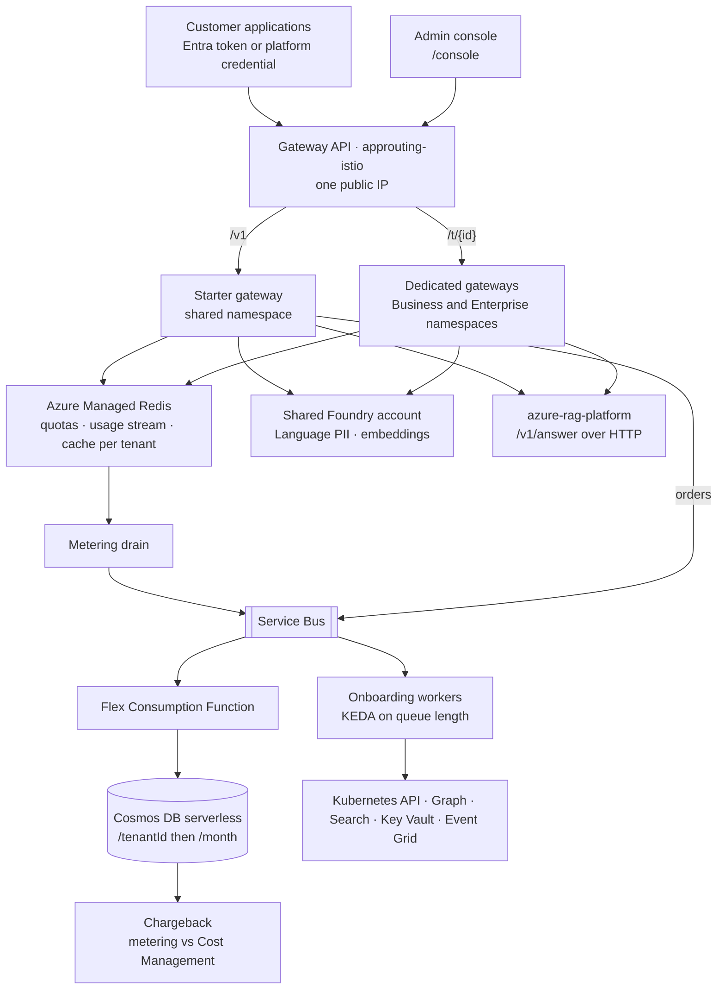

# Regulatory Intelligence as a Service

The regulatory-intelligence platform in `azure-rag-platform` works. This repository is what turns it
into a business: the same capability sold to a hundred companies, each onboarded in under two minutes,
isolated from the others in compute, data and quota, metered as an event stream, and costed from two
independent sources so that the gross margin per plan is a measured number rather than a hope.

*The recording of a customer being onboarded, from the company name to the first credential, belongs
here. It is on the end-of-build list and is added once it exists; `docs/onboarding.md` is its script.*

> Every tenant in this repository's fixtures, benchmarks and examples is an invented company. No
> customer data, name or contact exists anywhere in it.

**This repository contains no agent, by decision.** The gateway authenticates, meters, caches,
redacts and forwards; none of that is open-ended or tool-driven. The agents live upstream in
`azure-rag-platform`, which this repository treats as a service over HTTP (ADR-007, ADR-012).

## The problem

The buyer is a product director, and the question is margin. If serving a twenty-person consultancy
costs the same as serving a multinational, there is no business, however well the platform answers.
So the questions change: what does each customer cost to serve this month, in euros; can one customer's
traffic degrade another's; can one customer's data ever reach another's index; how fast can a customer
be onboarded, and by whom. This repository answers each of them with a measurement or a test rather
than a sentence, and `docs/cost.md` reconciles the two sources of cost and explains the gap between them.

## Architecture



Three plans, three levels of isolation, each one priced (ADR-002):

| Boundary | Starter | Business | Enterprise |
|---|---|---|---|
| Namespace and scheduling | shared `tenants-starter`, priority 1,000, evicted first | dedicated `t-<id>`, own deployment, priority 10,000 | dedicated `t-<id>` on the Enterprise node pool, priority 100,000 |
| Quota and limits | 1 CPU / 1 Gi, HPA 1–3 | 2 CPU / 2 Gi, HPA 2–5 | 4 CPU / 4 Gi, HPA 2–10 |
| Search | shared index | dedicated index | dedicated index |
| Cosmos | partition in the shared container | dedicated container | dedicated database |
| Credential | Key-Vault-signed API credential | Entra app registration with the role `tenant:<id>`, plus the credential | same |
| Quota of money | 20 € a month, 20 requests a minute | 200 €, 120 a minute | 2,000 €, 600 a minute, burst |

The network between tenants is default deny, the only networking this portfolio deploys (ADR-013), and
`docs/architecture.md` draws the container, network and per-tier isolation diagrams.

## What this demonstrates

| Claim | Evidence in this repository |
|---|---|
| One tenant cannot reach another's record, credential, quota, cached answer, usage or index | `tests/test_isolation.py::test_tenant_a_cannot_reach_tenant_b`, parameterised over the six stores; the tenant is read from the token claim only (`app/tenancy.py`) |
| A tenant at its ceiling is rejected before any upstream call is made | `tests/test_gateway.py::test_tenant_at_its_ceiling_is_rejected_before_any_upstream_call`, asserting on the upstream recorder |
| Usage recorded equals usage consumed, within 2 %, over a simulated month | `tests/test_metering.py::test_metering_accuracy_over_a_simulated_month` |
| A cross-tenant cache hit is impossible by construction | one RediSearch index per tenant over keys prefixed by the tenant (`app/cache.py`); `tests/test_metering.py::test_redisearch_keys_and_index_carry_the_tenant` |
| The request path never writes billing data synchronously | Redis Stream → consumer group → Service Bus → Function → Cosmos (`app/metering.py`, `functions/aggregate.py`, ADR-004) |
| The RAG platform is consumed over HTTP against its contract, with a circuit breaker and a stated degradation | `app/upstream.py`, `docs/upstream-openapi.json`, `tests/test_gateway.py::test_circuit_breaker_opens_after_failures_and_probes_after_the_reset` (ADR-007) |
| The PII policy is per tenant and respects the service limits | `app/privacy.py`, `tests/test_gateway.py::test_pii_policy_decides_what_leaves_and_what_is_kept`, `test_redaction_respects_the_service_limits` (ADR-008) |
| A customer is onboarded in under two minutes with every artefact the plan sells | `ops/onboard.py`, `tests/test_operations.py`, `docs/onboarding.md`; the time is measured by the command and by `load/onboarding.js` |
| The cost per tenant comes from two independent sources, reconciled | `ops/chargeback.py`, `tests/test_operations.py::test_chargeback_reconciles_both_sources_and_explains_the_gap`, `docs/cost.md` |
| No plaintext credential is persisted anywhere | hashes in Cosmos, signing in Key Vault, sealed delivery to the console (`docs/security.md`) |

**When the RAG platform is down**, the gateway answers 503 with `Retry-After`, releases the tenant's
quota reservation and keeps serving questions whose answers are in the tenant's cache; new questions
wait until the circuit closes (ADR-007).

## Quick start

```
python -m venv .venv && . .venv/Scripts/activate      # or .venv/bin/activate
make install                                           # the pinned dependencies, ruff, mypy, pytest, fakeredis
make check                                             # ruff, ruff format, mypy, pytest (44 tests, no Azure needed)
make kube-validate                                     # kubectl kustomize per overlay, then kubeconform -strict
make console                                           # npm ci, tsc, esbuild → console/dist
```

The tests need no Azure resource: Redis is `fakeredis`, the RAG platform is a recorded stream, Cosmos
and Search are in-memory doubles, Entra tokens are signed with keys the test suite generates.

## Deploy

The infrastructure is deployed from a workstation; the workflows deploy the cluster workloads.

```
make lz-env                                            # imports the landing zone's outputs into the azd environment
eval "$(azd env get-values | sed 's/^/export /')"
make preview && make deploy                            # what-if, then the full template (about 40 minutes, the cluster)
bash ../p04-graph-grants.sh                            # the Entra objects Bicep cannot hold, once; see docs/security.md
make image                                             # az acr build into the shared registry
make deployment-env | tee -a .env                      # the outputs the manifests need, plus TAG
bash k8s/render.sh && make apply-k8s && make rollout   # the platform and the starter namespace
```

`deploy.yml` does the last three steps from GitHub with its own identity (`workflow_dispatch`, OIDC,
docker build and push, render, apply, rollout status, rollback on failure); `load.yml` runs the k6
scenarios and returns the results as an artifact; `chargeback.yml` produces the monthly report; `ci.yml`
runs ruff, mypy, pytest, the budget, Bicep build and lint, the console build, kubeconform on every
kustomization, gitleaks over the full history with the email and GUID rules, and trivy. The workflows
read three repository variables, `API_AUDIENCE`, `UPSTREAM_AUDIENCE` and `UPSTREAM_URL`, and the three
`AZURE_*` secrets of the CI principal; the load workflow adds the two load tenants' credentials.

**Three federated credentials, not two.** The CI principal trusts the subjects `ref:refs/heads/main`,
`pull_request` and `environment:production`. A job that declares `environment: production` presents the
third subject, not the branch, and without a matching credential Entra answers `AADSTS700213`, "no
matching federated identity record found". The deploy workflow runs in that environment so that a named
reviewer can be required before anything reaches the cluster.

## Onboarding a customer

```
make onboard NAME="Globex Industries" PLAN=business PII=before_storage
```

The command prints each of the eight steps with its duration and ends with the elapsed time and the
customer's first credential, shown once. The same steps run behind the console at `/console`, where
the operator signs in with Entra, submits the company name and the plan, watches the steps complete and
receives the credential sealed to the browser session. Business and Enterprise customers also get an app
registration holding the `tenant:<id>` role on the gateway, so they can move from the credential to
Entra tokens. `docs/onboarding.md` has the per-plan table, the prerequisites and the recording script.

## Load tests and operations

`load/` holds the three k6 scenarios, baseline, noisy neighbour and concurrent onboarding, and the
in-cluster stub they run against so that no load test ever spends a model token. `docs/benchmarks/`
records the method and will hold each published run with its date, configuration and SKUs; no result is
published yet, because the cluster has not run under load. The noisy-neighbour run publishes the
protected tenant's p95 with and without quota enforcement, the one chart the thesis rests on.
`docs/operations/slo.md` states the objectives per tier, the error budget policy, the designed order of
degradation and the disaster recovery runbook with its RTO and RPO.

## Unit economics

Modelled in `docs/cost.md` from the retail prices of 2026-10-21 and the inference cost the RAG platform
measured; the monthly chargeback report replaces the model with billed figures.

| Plan | Price | Gross margin at the plan's ceiling | Gross margin at thirty percent of the ceiling |
|---|---|---|---|
| Starter | 49 € | 58.6 % | 87.2 % |
| Business | 490 € | 58.6 % | 87.2 % |
| Enterprise | 2,900 € | 27.9 % | 76.1 % |

The platform costs about 178 € a month at rest and 6 € a day; the first Enterprise tenant adds a node.
ADR-010 is the cost model that rejects a database per tenant, with the counts at which the model breaks.

## Identities and roles

| Identity | Runs as | Holds |
|---|---|---|
| `id-saasgw` | tenant gateways, metering drain | Cosmos data contributor, Redis access policy, Service Bus sender, Event Grid sender, Cognitive Services User and OpenAI User on the shared Foundry account, `Rag.Query` on the RAG platform's API |
| `id-saasfn` | the Function, the KEDA operator | Cosmos data contributor, Service Bus Data Owner, Storage Blob Data Owner on its own storage |
| `id-saasonboard` | onboarding workers, the operator's shell | Cosmos data contributor and Cosmos DB Operator, Service Bus receiver, Event Grid sender, Key Vault Crypto User (sign only), Search Service Contributor and Index Data Contributor, Managed Identity Contributor on `id-saasgw`, two Graph application permissions |
| `gh-azure-ai-saas-platform` | the workflows | AcrPush, AKS RBAC Cluster Admin and User, Cost Management Reader, Cosmos data reader, `Platform.Admin` |

Every identity is federated to a Kubernetes service account or a GitHub subject; no client secret exists.
`docs/security.md` has the full table and the multi-tenancy threat table, each threat mapped to the file
and the test that mitigates it.

## Decisions

| ADR | Decision |
|---|---|
| [001](docs/adr/001-aks-where-container-apps-was-right-elsewhere.md) | AKS here, when Container Apps was right in the other three repositories |
| [002](docs/adr/002-three-tier-isolation-model.md) | The three-tier isolation model and what each tier shares |
| [003](docs/adr/003-quota-enforcement-before-work.md) | Quota enforcement before work |
| [004](docs/adr/004-metering-as-an-event-stream.md) | Metering as an event stream |
| [005](docs/adr/005-hierarchical-partition-keys-in-cosmos.md) | Hierarchical partition keys in Cosmos, and what serverless cannot show |
| [006](docs/adr/006-per-tenant-semantic-cache.md) | A per-tenant semantic cache and the breach it prevents |
| [007](docs/adr/007-consuming-the-rag-platform-over-http.md) | The RAG platform is consumed over HTTP, never imported |
| [008](docs/adr/008-per-tenant-pii-policy.md) | A per-tenant PII policy over a global switch |
| [009](docs/adr/009-spot-node-pool-and-what-it-costs-in-availability.md) | A spot node pool for the shared tiers and what it costs in availability |
| [010](docs/adr/010-no-database-per-tenant.md) | Rejection: no database per tenant, with the cost model that decides it |
| [011](docs/adr/011-no-front-door-at-this-scale.md) | Rejection: no Front Door at this scale, and the traffic level at which that reverses |
| [012](docs/adr/012-no-agent-in-the-gateway.md) | Rejection: no agent in the gateway |
| [013](docs/adr/013-network-policy-as-the-only-networking-this-portfolio-deploys.md) | Cluster-level network policy, the only networking this portfolio deploys |

## Scope and simplifications

- **Size.** The specification asks for at most 50 files and 1,200 lines of Python. Its own mandated
  layout does not fit in either, so `tests/test_budget.py` enforces the counting rule in `CLAUDE.md`:
  at most 90 tracked files outside `docs/`, raised once from 80 in phase 9 because the console, the three
  k6 scripts, the stub and the four workflows did not fit; 1,700 lines of application Python (`app/`,
  `ops/`, `functions/`), raised once from 1,200 in phase 8 because onboarding and chargeback did not fit
  the 170 lines the specification's module table gives them; 900 of support Python (`tests/`, `load/`),
  raised once from 600 in phase 7 because the three thesis tests carry their own doubles; 600 lines of
  Bicep, raised once from 500 in phase 3; 500 of YAML under `k8s/`; 700 of TypeScript; fewer than 25
  comment lines. The counts at the end of the build: 87 files, 1,692 and 898 lines of Python, 574 of
  Bicep, 445 of YAML, 215 of TypeScript, 0 comments.
- **One region, Free control-plane tier, one system node at rest.** The estate runs intermittently and
  is sized for that; `docs/operations/slo.md` states the production posture for the Enterprise objective.
- **The per-tenant index is sent but not yet honoured.** The RAG platform answers from its configured
  index until a small change in its repository accepts the `index` field, the author's pull request.
- **Managed NGINX is not used.** The application routing add-on's NGINX loses support after
  November 2026, so the cluster uses the add-on's Gateway API implementation.
- **No Front Door, no private networking, no agent**, each a recorded decision (ADR-011, ADR-013, ADR-012).
- **The load tests run against a stub**, and no result is published until the cluster has run under load.
- **Starter customers authenticate with a platform credential**, Business and Enterprise customers with
  either the credential or an Entra token from their own app registration; client credentials for that
  registration are issued by the platform operator on request.
