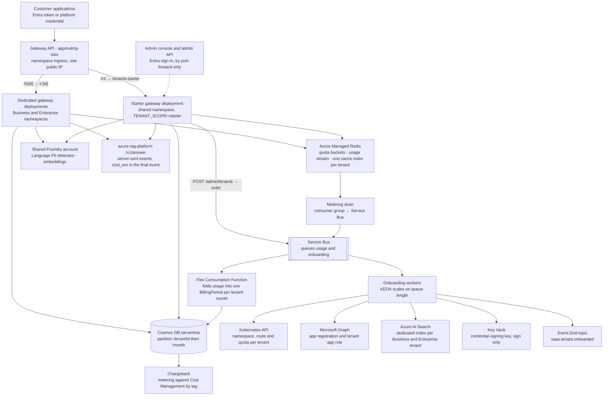
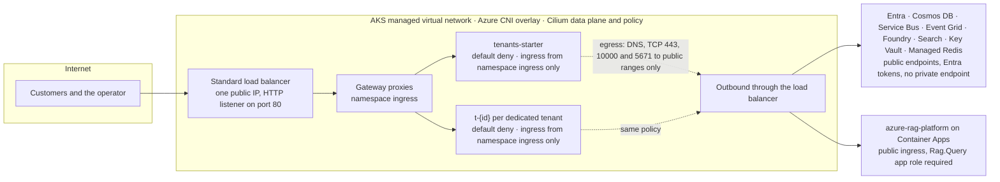
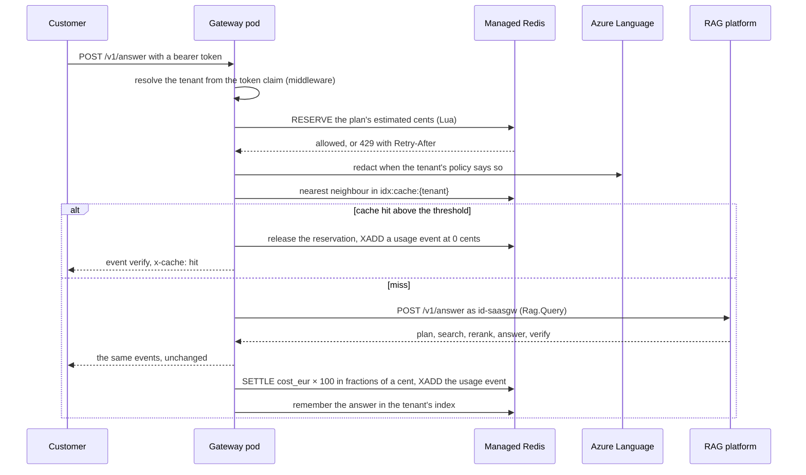

# Architecture

Regulatory Intelligence as a Service is a multi-tenant gateway in front of the RAG platform in
`azure-rag-platform`, consumed over HTTP against its OpenAPI contract and never imported (ADR-007). The
gateway owns everything a hundred paying customers add to a platform that already works: tenant
resolution, quotas, metering, a per-tenant semantic cache, a per-tenant PII policy, onboarding and cost
attribution. This document holds the container diagram, the network diagram, the tenant isolation
diagram per tier, the request path and the identities.

## Container diagram

The gateway image is one container (`Dockerfile`) that runs as the tenant gateways, the metering drain
and the onboarding workers, selected by the deployment's arguments. The Function is packaged on its own
(`functions/`) and shares no code with the gateway.

## Network diagram

**There is no peering, in either direction.** The audit expects a diagram with both peerings; the estate
has none to draw. The landing zone deploys no spoke virtual network, no hub, no private endpoint and no
private DNS zone, and its ADR-002 records why: identity is the security boundary for these workloads and
private networking would add cost and operations for no capability they need. The cluster lives in the
virtual network AKS manages for it, every Azure service is reached at its public endpoint with an Entra
token, and the only networking this repository deploys is the default-deny network policy inside the
cluster, where identity cannot stop one pod from calling another (ADR-013).

## Tenant isolation per tier

```mermaid
graph LR
    subgraph starter["Starter · shared"]
        direction TB
        SN["namespace tenants-starter<br/>one gateway deployment for every Starter tenant<br/>HPA 1–3 · ResourceQuota 1 CPU / 1 Gi · priority 1,000"]
        SR["Redis keys quota:{{id}}:* and index idx:cache:{id}"]
        SI["shared index regulations, scoped by the gateway"]
        SC["Cosmos: partition /tenantId in the shared usage container"]
        SK["Key-Vault-signed credential, no Entra object"]
        SN --- SR --- SI --- SC --- SK
    end
    subgraph business["Business · dedicated namespace"]
        direction TB
        BN["namespace t-{id}, own deployment<br/>HPA 2–5 · spot preferred · ResourceQuota 2 CPU / 2 Gi · priority 10,000"]
        BR["Redis keys and cache index of its own"]
        BI["dedicated index t-{id}"]
        BC["Cosmos: container usage-{id}"]
        BK["Entra app registration with the role tenant:{id}, plus the credential"]
        BN --- BR --- BI --- BC --- BK
    end
    subgraph enterprise["Enterprise · dedicated namespace and node pool"]
        direction TB
        EN["namespace t-{id}, own deployment on the enterprise pool<br/>taint and required affinity · HPA 2–10 · ResourceQuota 4 CPU / 4 Gi · priority 100,000"]
        ER["Redis keys and cache index of its own"]
        EI["dedicated index t-{id}"]
        EC["Cosmos: database t-{id}"]
        EK["Entra app registration with the role tenant:{id}, plus the credential"]
        EN --- ER --- EI --- EC --- EK
    end
```

What every tier shares, by construction and by price: the cluster and its control plane, the Gateway and
its proxies, the Managed Redis instance, the Cosmos account, the Service Bus namespace, the Function, the
search service and the RAG platform. ADR-002 prices each boundary; ADR-005 states what serverless Cosmos
cannot isolate; `tests/test_isolation.py` proves, store by store, that a request authenticated as one
tenant cannot read another's record, credential, quota, cached answer, usage or index.

## The request path

The order is the point: the tenant is known before any store is touched, the reservation precedes every
call that costs money, and the request path never writes a billing row (ADR-003, ADR-004).

## Identities

| Identity | Runs as | Federated subjects |
|---|---|---|
| `id-saasgw` | every tenant gateway and the metering drain | `tenants-starter/gateway`, `platform/meter-drain`, one `t-{id}/gateway` per dedicated tenant, added at onboarding |
| `id-saasfn` | the Function and the KEDA operator | `kube-system/keda-operator`; the Function itself through its own identity binding |
| `id-saasonboard` | the onboarding workers and the operator's shell | `platform/onboarding` |
| `gh-azure-ai-saas-platform` | the four workflows | `ref:refs/heads/main`, `pull_request`, `environment:production` |

`docs/security.md` lists what each one may do and why nothing else is granted.
